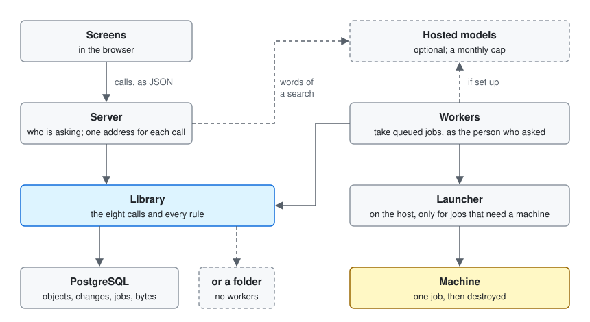

# Architecture

CRAFT is one library of objects, a server that answers calls to it, workers that carry out jobs, and screens in the browser.

## The library

Everything is an object: a text, a table, a space, a conversation, a person's settings. All objects have the same parts.

| Part | What it is |
|---|---|
| content | the thing itself, in the shape its kind declares |
| meta | what people say about it: title, owner, access, tags, date, links |
| about | a few facts read from the content, for lists and filters |
| vector | what it means, as numbers, for search by meaning; where a model is set up and the object holds prose |

A kind is a file of data in `app/design`. It says what the content may hold, what text it exposes and what is checked. It holds no code. `app/design/envelope.json` says what all kinds share.

Every change is kept as a version: what changed, who made it, when and why. Any older version that was not squashed is read back by replaying the changes. Copies, merges and restores are versions too.

## The calls

There are eight ways in, and no other.

| Call | What it does |
|---|---|
| pull | read objects, now or as they were at a version or a time, or as a file |
| history | read an object's changes |
| find | search by words, meaning, fields or SQL |
| push | change an object or make one; also copies, merges, restores and imports |
| run | ask for a job |
| squash | make an object's early changes into one |
| remove | take an object in the bin away for good, or cancel a job |
| sweep | delete bytes that no version names any more |

A push works out the smallest change, checks that the caller may write each part of it, checks the result against the rules of its kind, and lands whole or not at all. Two people who change different pieces both land. Where both change the same piece, a writer who said which version they read is refused, with what it was, what it is and what was wanted. One who did not say so lands, and the history keeps what was there before.

The rules are in `app/store.py`, with `app/checks.py`, `app/copies.py` and `app/runs.py` beside it. Who may do what is on [access](access.md).

## Where it is kept

The same store runs over three places. Its rules do not change between them.

| Kept in | How | Used for |
|---|---|---|
| memory | plain Python values | the checks |
| a folder | each call that changes something is written to a file, and run again in order at opening | one server, no database, no worker: jobs wait, and so do uploaded files |
| PostgreSQL | one call is one transaction; changes go one at a time under a lock; reads take no lock; a server answers what is large, and searches through text, one at a time beside the rest | a site with workers, and libraries larger than memory |

In PostgreSQL the tables are objects, changes, jobs and blobs (bytes, each kept once under its fingerprint), the text index, and a small table of counts, where the month's spending on models is. The text index is written with the change itself, so a search by words is never behind. Vectors are a column on the objects, using pgvector. See `app/pg.py`, `app/tables.py` and `app/library.sql`.

People, password hashes and sessions are not objects. They are two files in the server's folder.

## The server

`app/server.py` has one address for each call, with JSON in and out, and gives the built screens. It asks who is signed in before it reads anything more, reads every request against a deadline, and says what goes wrong in plain words. It logs the kind of an error and nothing a call carries. It reads no file that people upload: it keeps the bytes and queues the [import](machines.md), and its process does not load what reads them. It writes the files that are downloaded.

A program asks as a screen does, with `POST /library/<call>` and the call's arguments as a JSON map, named as `app/store.py` names them, but `from` and `as` without the underscore. `signin` takes `user` and `password` and answers with a session cookie, which each call then carries; `me` says whose it is and `signout` ends it. A call that can change something must also say that it comes from this site, in its `Origin`. What is refused says why, under `refused`.

SQL over tables runs in a process of its own, in a small database in memory that holds only the tables the query names. The process has a time limit and a memory limit, and holds no login (`app/sql.py`).

## Workers and the queue

The queue is the jobs table. A job is the request, the permission and the result in one row, so there is no second list to keep in step.

- A worker takes the kinds of job it is told to, several at once, and does each as the person who asked. An index job is CRAFT's own step and shows nobody anything.
- The next job is of the person with the fewest running, then of the one served longest ago, so nobody holds the queue.
- PostgreSQL wakes a worker when there is a job. It also looks every few seconds.
- A job whose worker stopped ends as failed, so it cannot save late. An index job, and one whose machine was lost, is queued again, a few times at most. An index job also waits for its model.
- A worker told to stop finishes what it has and takes no more.

| Job | What it does | Needs a machine |
|---|---|---|
| equation | fills a table's column from a script | yes |
| run | runs a notebook's cells | yes |
| import | reads an uploaded file into its object | yes |
| build | records which machine image jobs run in | yes |
| agent | Sprout answers a conversation | no |
| index | makes an object's vector | no |
| retype | adds a column or changes its type | no |

The worker is `app/worker.py`, which names the file of each step. Machines are on [their own page](machines.md).

## Hosted models

Two models are optional, one that answers for Sprout and one that makes vectors. Without them Sprout says it is not set up and search goes by words.

Sprout's model is sent what Sprout read as its asker. The vector model is sent the title, the description and the first part of the prose of every object, private ones too, and the words of a search. Both pay into one monthly meter with a cap: the most a request could cost is held before it is sent, so the cap is not passed. In a folder the meter is in memory and starts again with the server (`app/model.py`).

## The screens

The screens are a SolidJS app in `web`. A panel lists and searches; a view opens one object, and there is a view for each kind people open. Every read and change is one of the calls above. What a person types is a draft in their own browser until they commit it as one version. What they have open is a settings object, so it follows them to another browser.

## The path of a change

What happens from a person's typing to the tables:

1. What they type is kept as a draft by `web/src/draft.js`. Commit asks for the object's version, reads the object again if that is not the one on screen, and sends only the pieces they changed, as one push, under the one note.
2. `web/src/library/ask.js` sends it, with the session and the name of whose screen it is.
3. `app/server.py` finds out who asks before it reads the body, looks once more after it, and makes the call.
4. `app/pg.py` makes the call one transaction, under the library's lock. In a folder it is written to the file of calls.
5. `push` in `app/store.py` looks whether the asker may read the object, works out the smallest change, and looks whether they may write each path in it. `check` in `app/checks.py` then holds it to the rules of its kind.
6. `_write` in store.py keeps the change, the object's new row, its words for search and its job, through `app/tables.py`, and queues an index job when its prose changed.
7. A refusal is kept as a failed job. Any other error leaves nothing behind.
